<p align="center"><b>波 nami</b> &nbsp;<i>noun</i> &nbsp;A wave: the water rising, moving on, and coming back.</p>

<p align="center">
  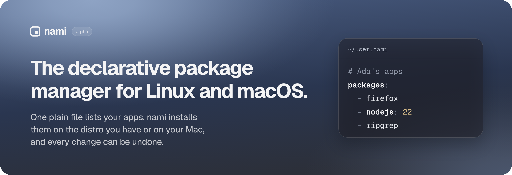
</p>

<p align="center">
  <a href="https://github.com/shiolabs/nami/actions/workflows/ci.yml"></a>
  <a href="LICENSE"></a>
</p>

<p align="center">
  <a href="#install">Install</a> ·
  <a href="docs/guide/README.md">Docs</a> ·
  <a href="https://namios.dev/packages">Search packages</a> ·
  <a href="CHANGELOG.md">What's new</a>
</p>

**nami is a declarative package manager for Linux and macOS.** You list the apps you want in one plain file, `~/user.nami`, and nami makes your computer match it. A `.nami` file is YAML: there's no new language to learn. It works on the distribution you already have (Ubuntu, Fedora, Debian, Mint, Arch and the others), next to apt or dnf, and on a Mac, and you can undo every change.

The packages are [nixpkgs](https://github.com/NixOS/nixpkgs)': over 140,000, in the version you ask for, ready-built and signed. You don't install or learn Nix. On a Mac, nami also installs Mac apps from Homebrew's casks, like `cask:rectangle`, into your Applications folder, without Homebrew.

<p align="center">
  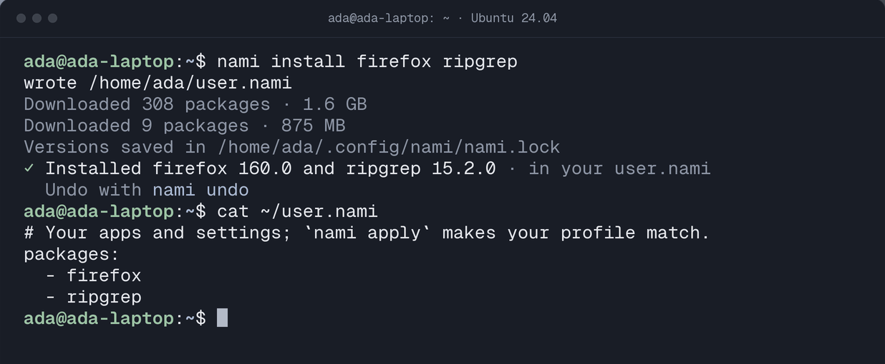
</p>

## Install

```sh
curl -fsSL https://namios.dev/install | sh
```

For Linux on x86_64 or ARM, and for Macs with Apple silicon or Intel and macOS 14 (Sonoma) or newer. It takes a minute or two, checks the download against its signed checksums, and you can [read the script first](docs/guide/install.md#read-the-script-first). nami is in alpha: if something isn't working, `nami report` tells us.

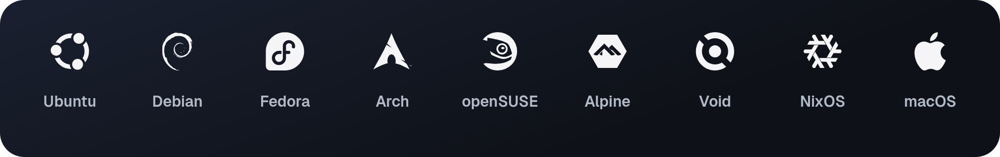

On a Linux desktop or a Mac it also adds the nami app. Don't want the app? Add `-s -- --no-app` after `sh`. To remove the app later: `sudo nami remove nami-gui` on Linux, or drag nami from Applications to the Trash on a Mac.

## Try it

Open a new terminal after installing. Install an app, see what you have, and take it back:

```sh
nami search ripgrep     # find a package (works offline)
nami install ripgrep    # install it; it's added to ~/user.nami
nami list               # what you have
nami undo               # take that back
```

What nami does, and the tools it does it instead of:


## Your setup is one file

Write what you want, and `nami apply` makes this computer match: it installs what's listed and removes what isn't. Each apply is a change you can go back to.

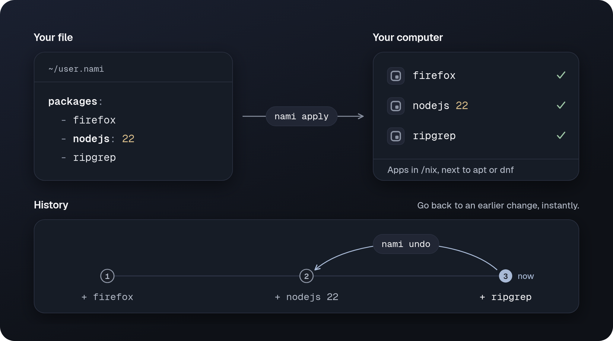

```yaml
# ~/user.nami
packages:
  - ripgrep
  - nodejs: 22                 # the newest 22.x
  - git:
      ~/.gitconfig:            # git's settings, kept with git
        user: { name: Ada }
aliases:
  ll: eza -l --git
env:
  EDITOR: hx
```

Add a line, apply, and it's there. Here Ada adds `nodejs: 22` in nano:

<p align="center">
  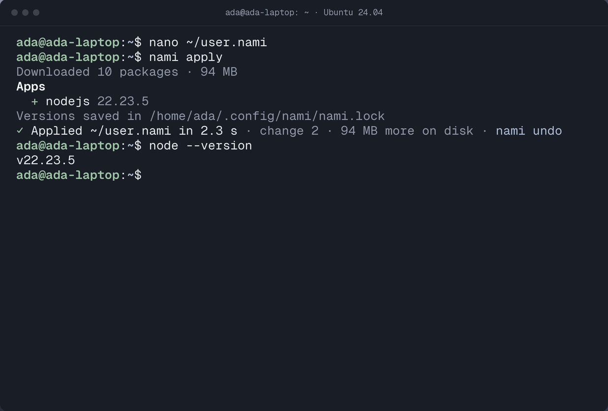
</p>

```sh
nami apply              # make this computer match ~/user.nami
nami history            # every change, to go back to
```

## Undo any change

Every install, removal, upgrade and apply is a change you can take back, instantly and with nothing to download. Your file goes back too, so the computer and `~/user.nami` always agree.

<p align="center">
  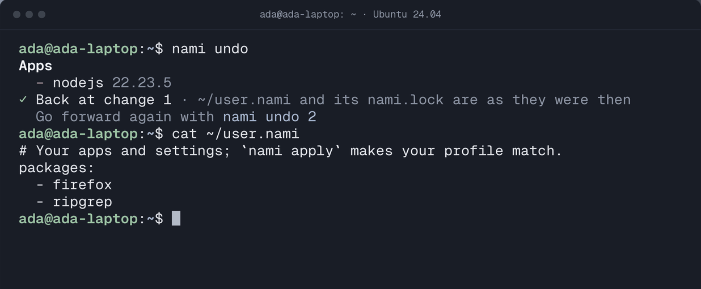
</p>

```sh
nami undo               # back one change
nami undo 2             # to any change you still have, forward or back
```

## Three files

They take the same keys. Which file you write in decides whose apps and settings they are.

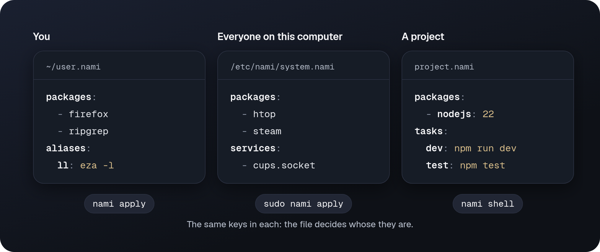

| File | For | Used by |
|---|---|---|
| `~/user.nami` | You: your apps, dotfiles, shell and services | `nami install`, `nami apply` (without sudo, or `--user`) |
| `/etc/nami/system.nami` | Everyone on this computer: apps, services, files in `/etc` | `sudo nami apply` (or `--system`) |
| `project.nami` | A project's tools, tasks and services, pinned by its `nami.lock` | `nami shell`, `nami run`, `nami up`, inside the project |

[Which file to use](docs/guide/user-nami.md#which-file-to-use) says more.

## Give each project its own tools

A `project.nami` in a project's folder lists the tools, tasks and services it needs. Everyone who clones it gets the same versions, pinned in `nami.lock`, and none of it is installed for the whole computer.

<p align="center">
  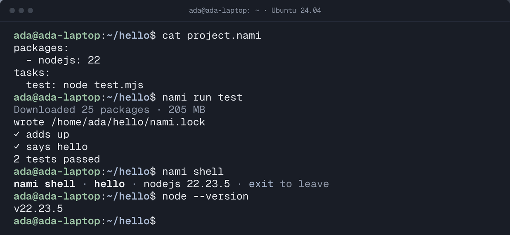
</p>

```yaml
# project.nami
packages:
  - nodejs: 22
tasks:
  dev: npm run dev
  test: npm test
services:
  - ./services/postgres.nami   # a database, run by nami: no containers or root
```

```sh
nami shell              # a shell with the project's tools
nami run test           # run a task
nami up                 # start its services
```

[Projects](docs/guide/projects.md) says more.

## Prefer clicking? Use the app

The nami app finds apps, keeps your setup, runs projects and goes back to an earlier change, without a terminal. It edits the same files as the `nami` command. The installer adds it when your computer has a desktop.

<p align="center">
  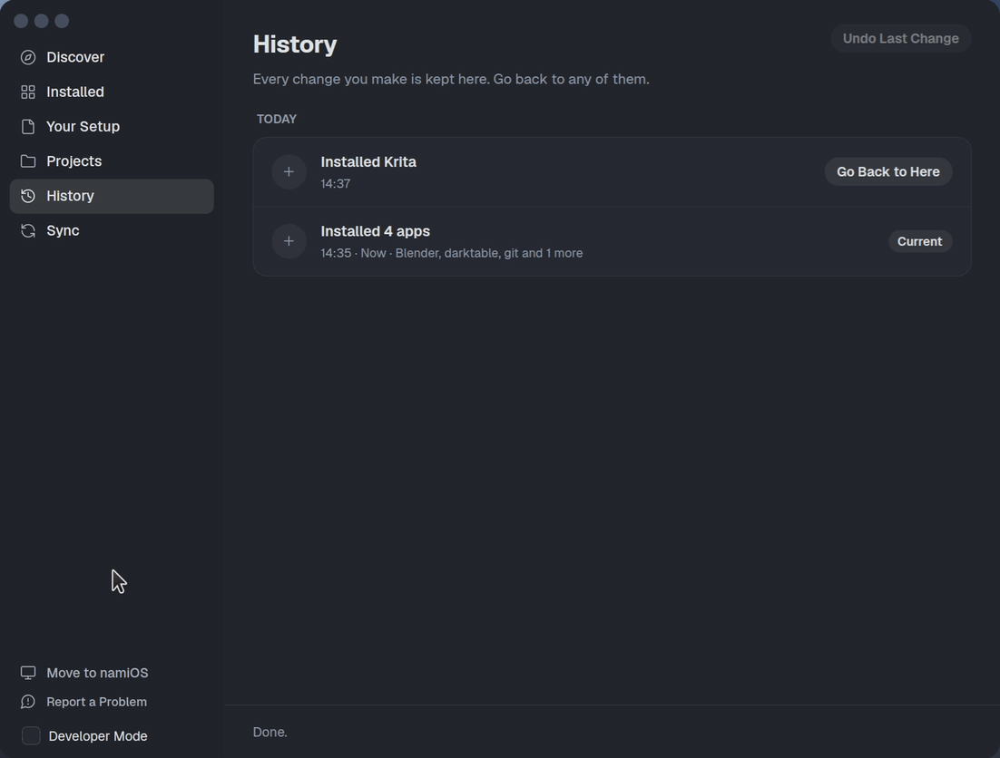
</p>

Discover, and the apps you have:

<p>
  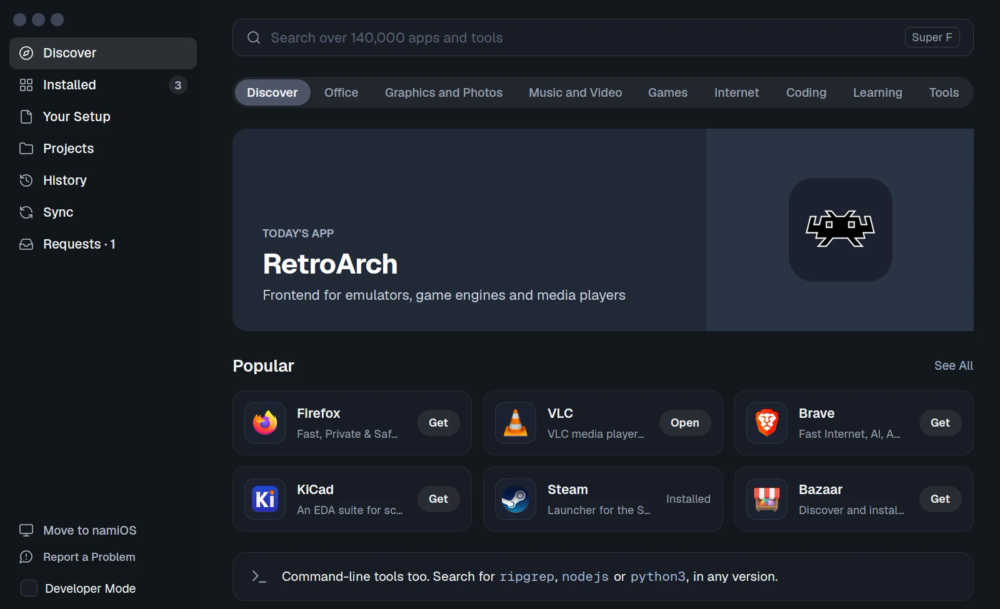
  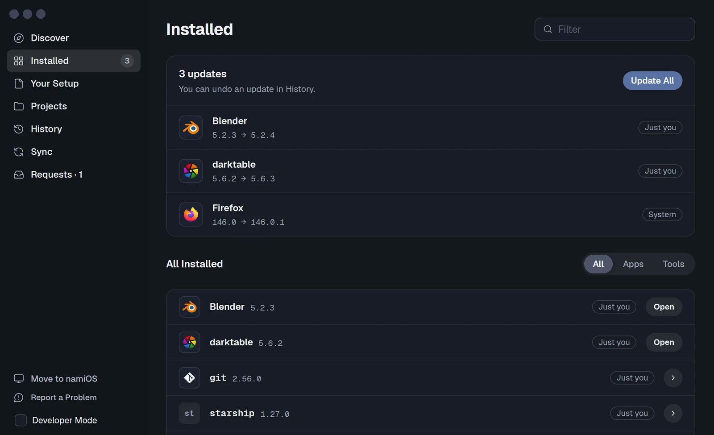
</p>

## Coming soon: namiOS

<a href="https://namios.dev/namios?ref=github#join">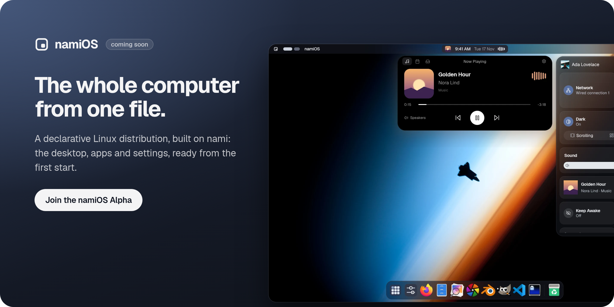</a>

The same files, one step further: on namiOS, `system.nami` holds the whole computer, its people, desktop and look as well as its apps. Change a line, or a setting in Settings, and it can be undone like any other change. [See namiOS](https://namios.dev/namios?ref=github), or [join the namiOS alpha](https://namios.dev/namios?ref=github#join) to try it first.

## Ship your app as one file

`nami bundle .` turns your Rust, Go, C/C++, Python, Node, Electron, Zig, Flutter or .NET project into one file that runs on other distributions, old and new, with nothing to install first. It updates itself, taking only updates signed with your key.

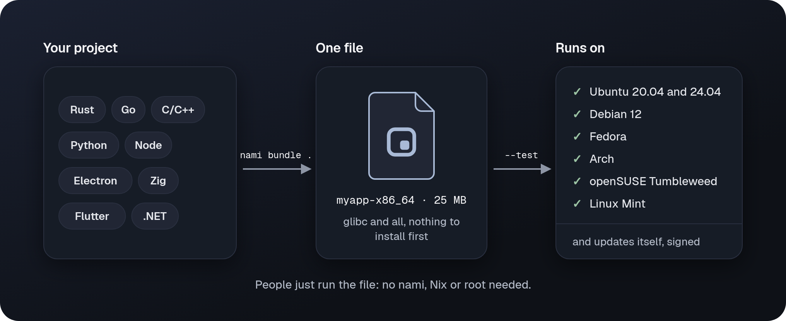

```sh
nami bundle .           # one file, with everything it needs
nami bundle . --test    # start it on seven distributions, each in a clean container
```

[Ship your app](docs/guide/ship-your-app.md) says how, and how to publish it.

## Not there yet

nami is alpha: most things work, some won't yet, and things change between releases.

- On a Mac, packages come ready-built only, `services:`, desktop `settings:`, Flathub apps and bundles are Linux's, and the nami app isn't notarized yet. [Install on a Mac](docs/guide/install.md#install-on-a-mac) has the list.
- nami doesn't run on Windows.
- Services in your files need systemd. On Alpine or Void, apps and files work.
- Bundles run on glibc distributions, not musl ones like Alpine. ARM bundles are for command-line programs from the catalog, and don't update themselves yet.

## Docs

- [The guide](docs/guide/README.md): installing, apps, your setup, projects, your own packages and shipping your app. The same pages are at [namios.dev/docs](https://namios.dev/docs/nami/install).
- The reference: [commands](https://namios.dev/docs/reference/commands), [options](https://namios.dev/docs/reference/options) and [examples](https://namios.dev/docs/reference/examples), or `nami --help` and `nami options`.
- [Search packages](https://namios.dev/packages).
- [CHANGELOG.md](CHANGELOG.md): what's in each release.

## Contributing

```sh
./build.sh              # the static binary, target/release/nami, built in a container
cargo test --release    # the unit tests, as yourself
```

Never run a nami you built with `sudo` on your own computer: try it in a container.

- [CONTRIBUTING.md](CONTRIBUTING.md): reporting problems, building, testing and sending a pull request.
- [ARCHITECTURE.md](ARCHITECTURE.md): how nami works inside, and where each part lives.
- [SECURITY.md](SECURITY.md): reporting a vulnerability, and what nami signs.
- [CODE_OF_CONDUCT.md](CODE_OF_CONDUCT.md).
- Contact: hi@shiolabs.dev. [Privacy](https://namios.dev/privacy): nami sends no usage data.


## Why nami

- **Any app, in any version.** Over 140,000 packages from nixpkgs, each with its own libraries, so nothing clashes with your distro. Ask for `nodejs: 22` or `python3@3.12` and get the newest of that line.
- **Your distro stays as it was.** Apps go in `/nix` and nami's own files in `/nami`, not `/usr`, so apt, dnf and your distribution's updates carry on as before.
- **The same setup on every computer.** Put `~/user.nami` in git, or turn on `nami sync`, and add an app on your laptop to have it on your desktop too.
- **Search is instant, and works offline.** The whole catalog is on your computer.

## How nami differs from Nix

nami is its own package manager, written in Rust. It uses nixpkgs' packages and their ready-built, signed downloads from cache.nixos.org, and works next to Nix and on NixOS. What's different:

| | Nix | nami |
|---|---|---|
| Your setup | Written in the Nix language | One plain file, `~/user.nami`, in YAML |
| Installing it | Nix, then often home-manager and flakes | One program; nothing else to install or learn |
| Finding a package | Evaluates nixpkgs on your computer | A signed catalog, already evaluated: search is instant and works offline |
| Picking a version | Pin a nixpkgs revision, or an overlay | `nodejs: 22`: the newest of that line |
| Dotfiles, settings, services | home-manager, NixOS modules | In the same file: `~/.gitconfig:`, `settings:`, `services:` |
| Going back | Generations of a whole profile | `nami undo`: each change, named, and what it changed |
| Software that isn't packaged | Write a derivation | `nami recipe from-url` writes the recipe from a project's link |

### Performance

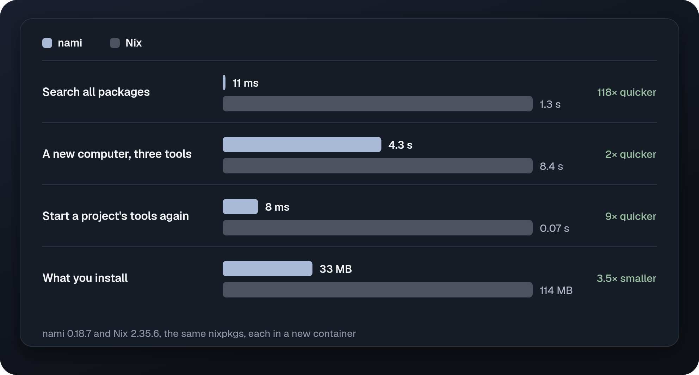

Measured November 19, 2026: nami 0.18.7 and Nix 2.35.6, the same nixpkgs from cache.nixos.org, the middle of three runs, each in a new container. [tests/bench/nami-vs-nix.sh](tests/bench/nami-vs-nix.sh) runs the same comparison on your computer.

Already use Nix? nami works next to it and on NixOS, sharing `/nix/store`, and `nami import` turns a home-manager configuration, a `shell.nix` or a flake into nami files ([Bring your Nix setup](docs/guide/install.md#bring-your-nix-setup)).

## Questions

<details>
<summary><b>Is nami just Nix with a YAML wrapper?</b></summary>

No. nami is its own program, in Rust, and doesn't run Nix to install anything. nixpkgs is evaluated once per release, ahead of time, into a signed catalog, so `nami install ripgrep` is a lookup. nami then downloads the ready-built packages from cache.nixos.org itself and checks the cache's signatures. What it shares with Nix is nixpkgs, cache.nixos.org and `/nix/store`. What it leaves out is the Nix language: anything a file can't say is a recipe, and `nami recipe from-url` writes one from a project's link.
</details>

<details>
<summary><b>Will it get in the way of apt or dnf?</b></summary>

No. Apps go in `/nix/store` and nami's own files in `/nami`, not `/usr`. What nami puts in `/usr` is links: the `nami` command, menu entries and tab completion. Your distribution's packages and updates carry on as before. [Files on disk](https://namios.dev/docs/reference/files-on-disk) lists every path.
</details>

<details>
<summary><b>Is <code>curl | sh</code> safe?</b></summary>

You can [read the script first](docs/guide/install.md#read-the-script-first). It downloads the release, checks it against its `SHA256SUMS` and their signature, and asks for your password once. `nami self-update` only takes a release signed by a key your computer already trusts.
</details>

<details>
<summary><b>Why not Flatpak, or Homebrew on Linux?</b></summary>

nami installs Flathub apps too (`nami install flathub:org.gnome.Calculator`) and keeps them in the same file. It goes further: command-line tools, libraries, any version, dotfiles, settings, services and each project's tools, all in your files, and every change can be undone.
</details>

<details>
<summary><b>What does nami send home?</b></summary>

No usage data and no ID for your computer. Once a day it asks namios.dev for the newest release and catalog (`updates: manual` turns that off), and it downloads packages from cache.nixos.org. `nami report` sends only when you run it, after showing you everything it would send. The [privacy page](https://namios.dev/privacy) has the details.
</details>

<details>
<summary><b>How do I remove it?</b></summary>

In the nami app, click **Uninstall nami…** at the bottom of **Installed** (on a Mac, it's in the **nami** menu too). In a terminal, run `sudo nami self-uninstall`, or `curl -fsSL https://namios.dev/uninstall | sh` if the `nami` command doesn't work any more. Either way it removes nami, every app installed with it and its store, and says so before it asks. Your nami files and your home folder stay. [Uninstall nami](docs/guide/install.md#uninstall-nami) has the rest.
</details>

<details>
<summary><b>Is it free?</b></summary>

Yes. nami is MIT-licensed, with nothing to pay for and no account.
</details>


---

<p align="center">
  By <a href="https://shiolabs.dev">Shio Labs</a> · MIT licence (<a href="LICENSE">LICENSE</a>); packages keep their own licences.
</p>
